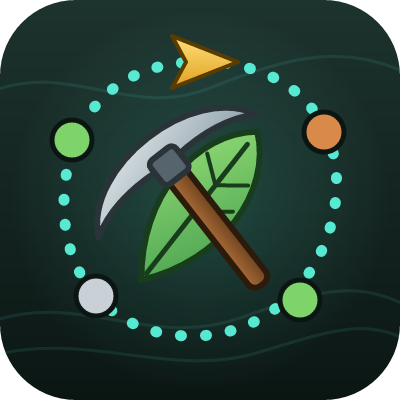

# Gatherwise Forever

Mining and herb nodes on your world map and minimap for **World of Warcraft: Forever**, filtered by your skill, with the shortest gathering route through your zone and an arrow that guides you from node to node.

On CurseForge as **Gatherwise Forever**; in game it's simply "Gatherwise" (addon folder `GatherwiseForever`). Not related to the GatherWise addon for TBC Classic.

## Features

- **17,000+ known spawn points** for every vein and herb, from Copper Vein to Black Lotus, plus every node you gather yourself.
- **Only what's relevant:** hide nodes above your Mining or Herbalism skill, and nodes that no longer give skill points.
- **World map and minimap** icons, with on/off options in the world map's filter menu.
- **Routes:** press **Alt+R** (or use the map menu) for the shortest loop past every node you can gather in your zone. The route avoids climbing up and down hills where it can.
- **Guide arrow** at the top of your screen, with the next node and its distance. It moves on by itself when you arrive or gather.
- **Works with Find Minerals / Find Herbs:** spawn points turn into faint rings so the real yellow dots stand out.
  - **Hover a yellow dot** and the route goes there first.
  - **Hover the target ring with no dot** (or press **Alt+S**) and the route skips it.
  - Visited and empty spots are skipped for 10 minutes.
- **Close-range detection** (optional): uses the game's soft-targeting to recognise a node right in front of you.

## Commands

| Command | What it does |
| --- | --- |
| `/gw` | Settings |
| `/gw route` | Start or stop routing (default key **Alt+R**) |
| `/gw skip` | Skip the current node (default key **Alt+S**) |
| `/gw mine`, `/gw herb` | Show or hide mining nodes or herbs |
| `/gw stats` | How many nodes are known |

Change the keys in **Esc > Options > Keybindings > AddOns > Gatherwise**.

## Good to know

- The game doesn't tell addons where the yellow Find Minerals / Find Herbs dots are. Gatherwise only learns about one when you hover it on the minimap.
- Spawn points are places a node *can* appear. Nodes move between spawn points, so not every spot has one at any time.
- The arrow points in a straight line; it doesn't know about walls or cliffs.

## Credits and licence

Spawn point data is generated from the [CMaNGOS classic-db](https://github.com/cmangos/classic-db) (GPL-3.0).

Gatherwise is free software under the [GNU General Public License v3.0 or later](LICENSE).
